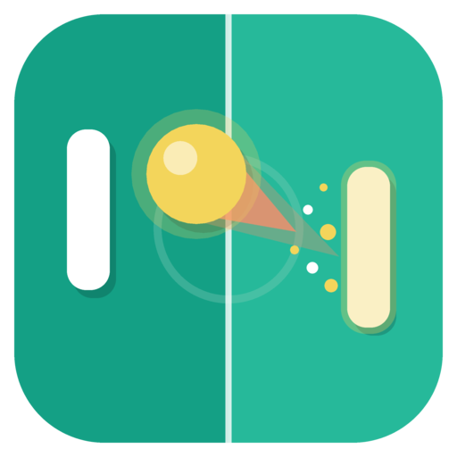
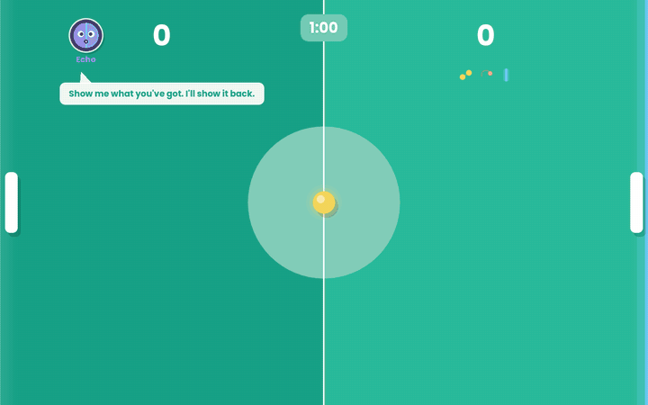
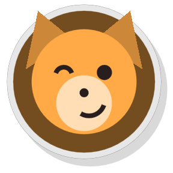
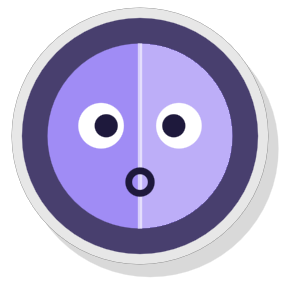
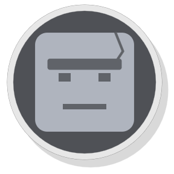
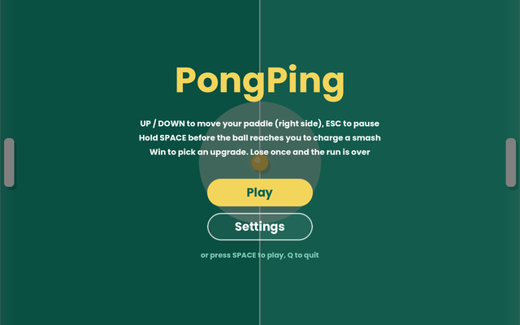
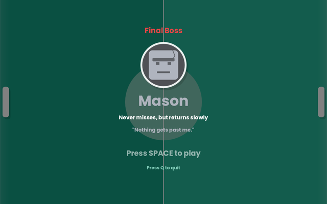
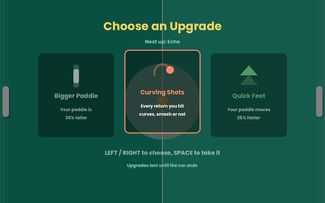
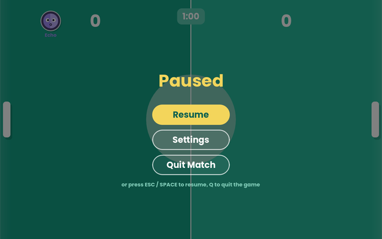
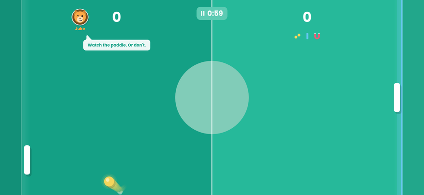

# PongPing

**A fast, timed take on the classic paddle game. Climb a ladder of rivals, grab upgrades, beat the boss.**

 

---

PongPing is a short, punchy single-player arcade game. Each run is a ladder of three one-minute
matches against rivals with their own personalities and tricks. Win and you choose an upgrade that
lasts the rest of the run. Lose once, and the run is over.

Every hit freezes, shakes, sparks and climbs in pitch, the court lights up as a ball closes in on a
goal, and the game slows down when a point is about to slip away. It plays as well with a finger on
a phone as with a keyboard on a Mac.

**[Read the full game concept →](CONCEPT.md)**

## 🥊 The rivals

<table>
<tr>
<td align="center" width="33%"> <b>Juke</b></td>
<td align="center" width="33%"> <b>Echo</b></td>
<td align="center" width="33%"> <b>Mason</b> · final boss</td>
</tr>
<tr valign="top">
<td><b>Fakes one way, aims the other.</b> Lines up for one angle, then switches late and sends the ball the other way.  <i>"Watch the paddle. Or don't."</i></td>
<td><b>Copies every shot you make.</b> Returns the ball at your angle, and smashes back when you smash.  <i>"Show me what you've got. I'll show it back."</i></td>
<td><b>Never misses, but returns slowly.</b> Reaches every normal shot. Only a smash, or a second ball, gets past.  <i>"Nothing gets past me."</i></td>
</tr>
</table>

## 🎁 Upgrades

After each win, pick one of three. They last until the run ends.

| | Upgrade | |
| :-: | --- | --- |
|  | **Split Ball** | Your first hit each rally splits the ball in two |
|  | **Curving Shots** | Every return you hit curves, smash or not |
|  | **Bigger Paddle** | Your paddle is 30% taller |
|  | **Goal Shield** | Blocks one goal against you, then breaks |
|  | **Magnet Pull** | Balls coming at you bend toward your paddle |
|  | **Quick Feet** | Your paddle moves 25% faster |
|  | **Quick Charge** | Smashes charge twice as fast |

## ✨ Features

- ⏱️ **One-minute matches**: the clock turns red for the final ten seconds, and a tie goes to sudden death
- ☄️ **Charged smash**: hold to charge a faster, curving power shot, at the cost of a slower paddle
- 🔥 **Building rallies**: every hit speeds the ball up, and the pressure rises as the clock runs down
- 💥 **Juicy feedback**: freeze frames, screen shake, sparks, and slow motion when a point is about to slip past
- 🥅 **Living goal lines**: they light up where a ball is closing in, and flare when a goal goes in
- 🎵 **A cozy soundtrack**: a theme for each rival, crossfading between screens
- 📱 **Made for phones too**: no on-screen controller, and a court that reshapes to fill any screen
- ⚙️ **Settings**: music and effects volume, and mute, remembered between sessions

## 📸 Screenshots

 
 

The title screen, a rival's intro, the upgrade picker, the pause menu, and a match on an iPhone

## 🎮 Controls

| | ⌨️ Keyboard | 👆 Touch |
| --- | --- | --- |
| **Move** | <kbd>↑</kbd> <kbd>↓</kbd> or <kbd>W</kbd> <kbd>S</kbd> | Drag anywhere |
| **Charge a smash** | Hold <kbd>Space</kbd> | Hold a second finger down |
| **Pause** | <kbd>Esc</kbd>, or click the timer | Tap the timer |
| **Choose an upgrade** | <kbd>←</kbd> <kbd>→</kbd> and <kbd>Space</kbd> | Tap a card, then tap it again |

## ⬇️ Get the game

### <picture><source media="(prefers-color-scheme: dark)" srcset="https://cdn.simpleicons.org/apple/ffffff"></picture> macOS

**[Download PongPing for macOS](https://github.com/edpsouza/PongPing/releases/latest/download/PongPing-macOS.zip)**, unzip it, and drag
**PongPing** into Applications. It runs on Apple Silicon and Intel Macs with macOS 11 or newer.

> [!NOTE]
> PongPing isn't notarized by Apple yet, so macOS blocks it the first time. Open it once, then go to
> **System Settings → Privacy & Security** and click **Open Anyway**.

### <picture><source media="(prefers-color-scheme: dark)" srcset="https://cdn.simpleicons.org/ios/ffffff"></picture> iOS

In testing on iPhone. A public release, through TestFlight or the App Store, is planned.

###  Windows

Planned, once it has been tested.

## 🙏 Credits

- Design and development by Eduardo De Souza
- Music and sound effects: *Cozy Tunes* and *Cozy FX*, game assets by Pizza Doggy
- [Poppins](https://fonts.google.com/specimen/Poppins) font by Indian Type Foundry
- Made with [Godot Engine](https://godotengine.org/)

Full third-party notices come with each download, in `THIRD-PARTY-NOTICES.txt`.

## 📄 License

© 2026 Eduardo De Souza. All rights reserved. This repository presents PongPing; its source code
isn't public. You're welcome to download and play the released builds for personal use, but the
game, its content and this repository may not be copied, modified or redistributed. See
[LICENSE](LICENSE) for the details.

Made with ☕ and Godot

