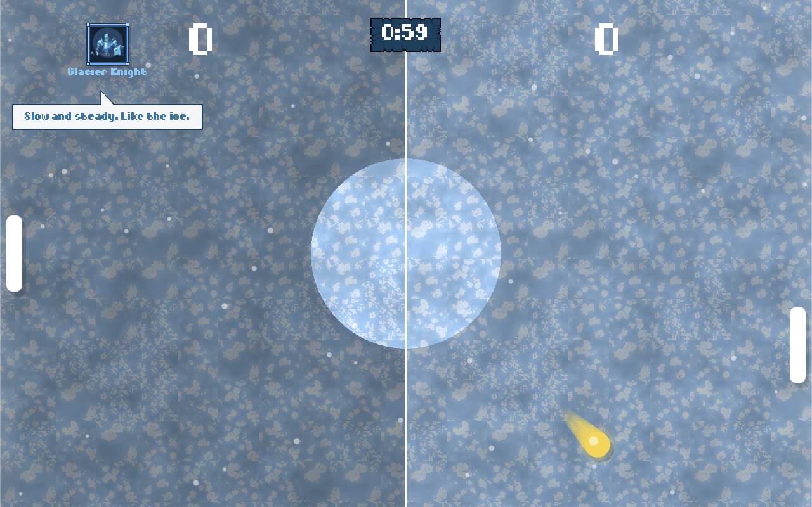
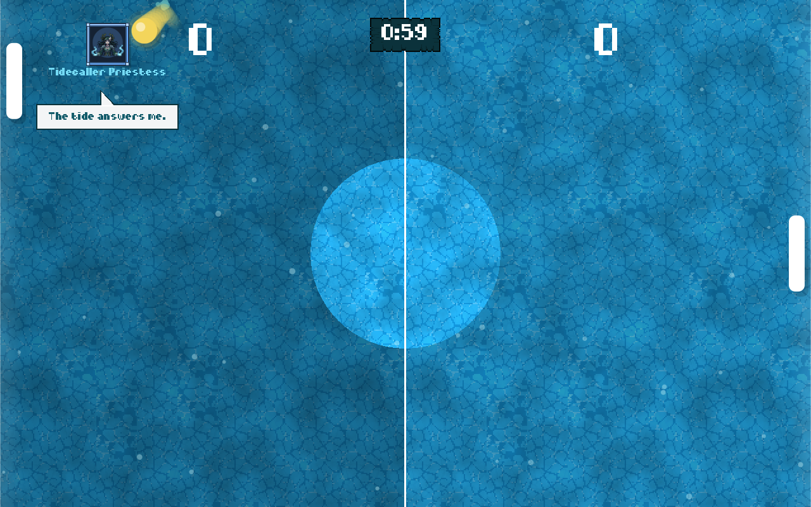
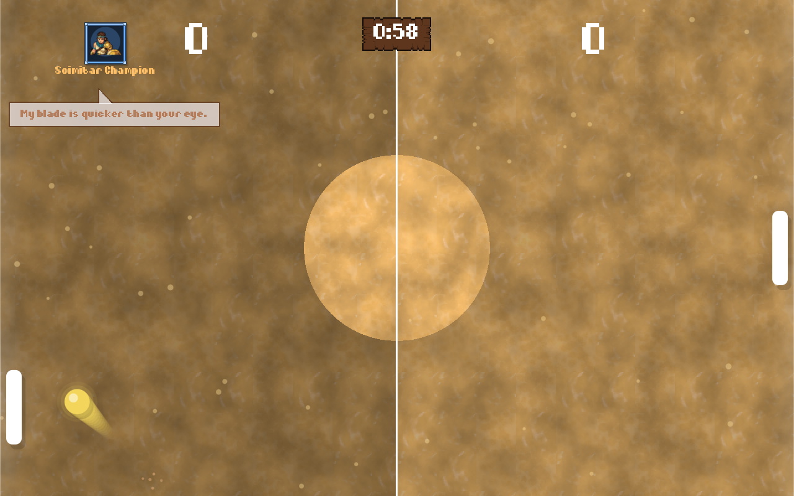
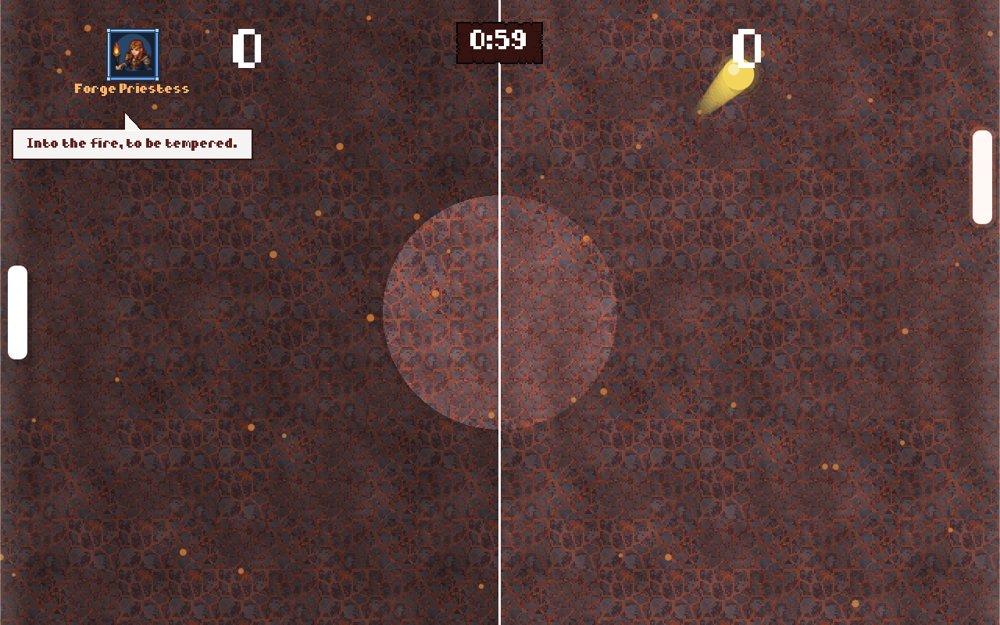
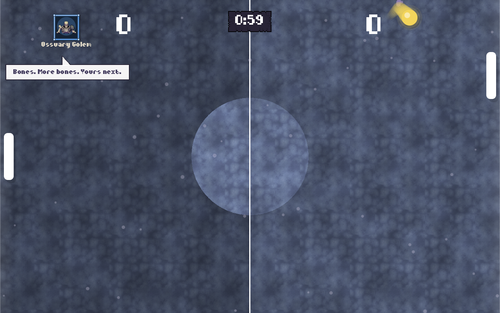
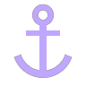
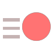
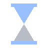
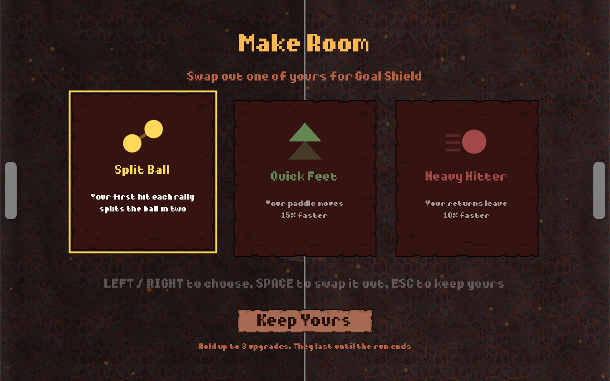

# Riposte

**A fast, timed paddle duel across five fantasy realms. Beat twenty rivals, survive their bosses' hidden powers, and pick your three upgrades well.**

 

---

Riposte is a single-player arcade game about the perfect return. Each run crosses five realms, each
with three rivals and a boss, for twenty one-minute matches. Every opponent in a realm shares its
ability, and every boss hides a super ability of its own, unleashed when the match turns against it.
Win and you take an upgrade, but you can only hold three. Lose once, and the run is over.

Every hit freezes, shakes and sparks, the court lights up as a ball closes in on a goal, and the
game slows down when a point is about to slip away. It's all pixel art, and it plays as well with a
finger on a phone as with a keyboard on a Mac.

**[Read the full game concept →](CONCEPT.md)**

## 🗺️ Five realms

Each realm has its own court, colors, weather, music and ability, shared by its three rivals and its
boss. Each realm opens a little harder than the last.

| | Realm | What its rivals do | Boss |
| :-: | --- | --- | --- |
|  | **Frozen Tundra** *The cold slows you down.* | **Frostbite**: catch an icy shot and your paddle chills. A smash shatters the ice. | Ice Elemental |
|  | **Sea** *The tide never runs straight.* | **Sidewinder**: their shots weave up and down like waves. | Pirate Captain |
|  | **Oasis** *Nothing is what it seems.* | **Mirage**: every return comes in threes, and only one ball is real. | Bandit Chief |
|  | **Volcano** *Everything here burns faster.* | **Heatwave**: shots leave slow and heat up as they cross. | Red Dragon |
|  | **Graveyard** *The dead take what's yours.* | **Reap**: every goal against you shortens your paddle, until you score back. | Lich King |

And every boss is hiding something worse. You'll find out what when it falls behind.

## 🎁 Sixteen upgrades, three slots

After each win, pick one of three. You can hold three at a time, so once your slots are full, taking
a new one means choosing which to give up. Five of them each counter one realm's ability, so it pays
to think about where you're going next.

| | Upgrade | | | Upgrade | |
| :-: | --- | --- | :-: | --- | --- |
|  | **Split Ball** | Your first hit each rally splits the ball in two |  | **Warm Gloves** | Chills and freezes last half as long |
|  | **Curving Shots** | Your returns bend further from a straight line |  | **Sea Legs** | Weaving shots weave half as much |
|  | **Bigger Paddle** | Your paddle is 30% taller |  | **True Sight** | Decoys glow red, and smoke can't hide the ball |
|  | **Goal Shield** | Blocks one goal against you, then breaks |  | **Heat Shield** | Heated shots never speed up past normal |
|  | **Magnet Pull** | Balls just past your paddle snap onto it |  | **Soul Anchor** | Reap can only shorten your paddle once |
|  | **Quick Feet** | Your paddle moves 15% faster |  | **Heavy Hitter** | Your returns leave 10% faster |
|  | **Quick Charge** | Smashes charge twice as fast |  | **Head Start** | Begin every match 1–0 up |
|  | **Focus** | Slow motion kicks in from twice as far |  | **Underdog** | While you're behind, your paddle is 30% faster |

## ✨ Features

- 🗺️ **A twenty-match run**: five realms, three rivals and a boss each, with the whole ladder shown on every intro card
- 👑 **Hidden supers**: every boss unleashes a power of its own once a goal puts it behind, or late in the match
- ⚖️ **Balanced by simulation**: every rival, ability and upgrade was tested over thousands of simulated matches, so each match is winnable and none is a formality
- ⏱️ **One-minute matches**: the clock turns red for the final ten seconds, and a tie goes to sudden death
- ☄️ **Charged smash**: hold to charge a faster, curving power shot, at the cost of a slower paddle
- 💥 **Juicy feedback**: freeze frames, screen shake, sparks, and slow motion when a point is about to slip past
- 🎨 **Pixel art throughout**: framed rival portraits, a textured court and weather for every realm, and a parchment UI that takes on each realm's colors
- 🎵 **A fantasy soundtrack**: a tavern tune for the menus, and a theme for each realm and each boss
- 📱 **Made for phones too**: no on-screen controller, and a court that reshapes to fill any screen

## 📸 Screenshots

 
 

The title screen, a boss's intro card, picking an upgrade, making room for a new one, and a match on an iPhone

## 🎮 Controls

| | ⌨️ Keyboard | 👆 Touch |
| --- | --- | --- |
| **Move** | <kbd>↑</kbd> <kbd>↓</kbd> or <kbd>W</kbd> <kbd>S</kbd> | Drag anywhere |
| **Charge a smash** | Hold <kbd>Space</kbd> | Hold a second finger down |
| **Pause** | <kbd>Esc</kbd>, or click the timer | Tap the timer |
| **Menus** | Hover, or the arrow keys, then <kbd>Space</kbd> | Tap a button |
| **Choose an upgrade** | <kbd>←</kbd> <kbd>→</kbd> and <kbd>Space</kbd> | Tap a card, then tap it again |

## ⬇️ Get the game

### <picture><source media="(prefers-color-scheme: dark)" srcset="https://cdn.simpleicons.org/apple/ffffff"></picture> macOS

> [!NOTE]
> The game shown here hasn't been released yet. The download below is **v0.1**, an earlier and much
> smaller build, released as *PongPing*: three rivals, seven upgrades and the original look. A new
> release will follow.

**[Download v0.1 for macOS](https://github.com/edpsouza/Riposte/releases/download/v0.1/PongPing-macOS.zip)**,
unzip it, and drag the app into Applications. It runs on Apple Silicon and Intel Macs with macOS 11
or newer. It isn't notarized by Apple yet, so macOS blocks it the first time: open it once, then go
to **System Settings → Privacy & Security** and click **Open Anyway**.

### <picture><source media="(prefers-color-scheme: dark)" srcset="https://cdn.simpleicons.org/ios/ffffff"></picture> iOS

In testing on iPhone. A public release, through TestFlight or the App Store, is planned.

## 🙏 Credits

- Design and development by Eduardo De Souza
- Music: *Pixel Fantasy 30 Tracks Music Pack* by AlkaKrab
- Sound effects: *Cozy FX* by Pizza Doggy
- Portraits: *Boss Portraits*, from itch.io
- UI art and pointer: [*Complete UI Essential Pack*](https://crusenho.itch.io) by Crusenho Agus Hennihuno, under [CC BY 4.0](https://creativecommons.org/licenses/by/4.0/); scaled up, recolored, and only some pieces used
- Ground textures: [*Pixel Art Tiles*](https://maraudergames.itch.io/pixel-art-tiles) by Marauder Games
- Font: *Diary of an 8-bit mage* by [Chequered Ink](http://chequered.ink)
- Made with [Godot Engine](https://godotengine.org/)

## 📄 License

© 2026 Eduardo De Souza. All rights reserved. This repository presents Riposte; its source code
isn't public. You're welcome to download and play the released builds for personal use, but the
game, its content and this repository may not be copied, modified or redistributed. Third-party art,
music and fonts belong to their creators, credited above. See [LICENSE](LICENSE) for the details.

Made with ☕ and Godot

